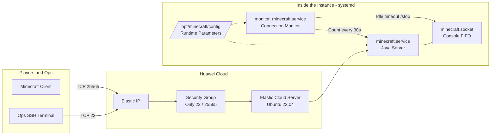

# Idle-Aware Minecraft Java Server on Huawei Cloud

[](LICENSE)
[](https://support.huaweicloud.com/intl/en-us/)
[](#)

> Quickly set up a Minecraft Java game server on Huawei Cloud that stops itself when nobody is playing.
> An idle-aware Minecraft Java game server: auto-deploy on first boot, graceful auto-shutdown when the last player leaves.

---

## 1. Overview [CRITICAL]

This practice deploys a Minecraft Java Edition server on a Huawei Cloud Elastic Cloud Server (ECS). On first boot the instance automatically installs the Java runtime, verifies the server jar, and registers systemd units. During operation a monitor service tracks connections on the game port; after the last player disconnects and the idle timer expires, the world is saved and the instance shuts down gracefully. Power the instance back on from the console whenever you want to play again. It targets game-server operators, DevOps engineers, and individual server owners as a reference architecture for game servers that start and stop with player activity.

### Core Capabilities

- **Deploy on boot**: after `terraform apply`, the full install and configuration completes automatically with no manual login
- **Idle auto-shutdown**: after players disconnect, a configurable timer (default 15 minutes) saves the world and shuts the instance down gracefully
- **Configuration separated from scripts**: heap size and idle threshold live in an instance-local config file; restart the services for changes to take effect
- **Version pinning and integrity check**: the server jar URL and its SHA1 checksum are fixed to prevent tampering or corruption
- **One-click create and destroy**: all resources are managed declaratively with Terraform

---

## 2. Table of Contents [MINOR]

- [1. Overview](#1-overview-critical)
- [2. Table of Contents](#2-table-of-contents-minor)
- [3. Architecture Diagram](#3-architecture-diagram-minor)
- [4. Highlights](#4-highlights-minor)
- [5. Cloud Services](#5-cloud-services-minor)
- [6. Prerequisites](#6-prerequisites-critical)
- [7. Quick Start](#7-quick-start-critical)
- [8. Step-by-Step Deployment](#8-step-by-step-deployment-minor)
- [9. Usage / Verification](#9-usage--verification-critical)
- [10. Cleanup](#10-cleanup-minor)
- [11. Detailed Reference](#11-detailed-reference-minor)
- [12. Dependencies](#12-dependencies-minor)
- [13. FAQ / Troubleshooting](#13-faq--troubleshooting-minor)
- [14. Contributing](#14-contributing-minor)
- [15. License](#15-license-critical)
- [16. Contact](#16-contact-critical)
- [17. Creator / Maintainer](#17-creator--maintainer-critical)

---

## 3. Architecture Diagram [MINOR]

> Players reach the game port through an Elastic IP behind a restricted security group; inside the instance, three systemd units form the "service / console / idle monitor" loop.



**Key Components**:

- **Elastic IP + Security Group**: player entry point, allowing only port 22 (ops) and 25565 (game); the source IP range can be restricted
- **Elastic Cloud Server**: 2 vCPU / 4 GB Ubuntu 22.04, with the world data on the system disk
- **minecraft.service / minecraft.socket**: game server plus a console FIFO (commands such as `/stop` and `/say` can be injected)
- **monitor_minecraft.service**: idle monitor that runs "save world, wait, shut down" after the timeout

---

## 4. Highlights [MINOR]

- **Zero-touch launch**: fully automatic from instance creation to a ready service, with all deployment logic captured in Terraform
- **Graceful shutdown, no lost world**: the console `/stop` command saves the world before power-off instead of killing the process
- **Runtime parameters adjustable**: heap size and idle threshold are externalized into a config file, decoupled from the business scripts
- **Minimal exposure**: two-port security group, a dedicated low-privilege service user, and no cloud API credentials on disk
- **Reproducible**: pinned server version and checksum produce the same result on every deployment

---

## 5. Cloud Services [MINOR]

| Service | Purpose | Notes |
|---|---|---|
| Elastic Cloud Server (ECS) | Runs the Minecraft server | s6.large.2 (2 vCPU / 4 GB), Ubuntu 22.04 |
| Virtual Private Cloud (VPC) | Network plane | 10.0.0.0/16, single availability zone |
| Subnet | Instance network attachment | 10.0.1.0/24 |
| Security Group | Access control | Inbound only 22 / 25565 |
| Elastic IP (EIP) | Player access and instance egress | Traffic-based, 5 Mbit/s |

> **Tip**: All services can be created with one click via the Terraform in this repository; for cleanup see [Section 10 "Cleanup"](#10-cleanup-minor).

> **Resource specifications and usage notes**: see [Section 11 "Detailed Reference"](#11-detailed-reference-minor).

---

## 6. Prerequisites [CRITICAL]

| Item | Requirement | Notes |
|---|---|---|
| **Account** | Huawei Cloud account with real-name authentication | Personal / enterprise accounts both OK |
| **Permissions** | Permission to create/delete VPC, ECS, EIP, and security groups | Tenant Administrator or equivalent |
| **Region** | `cn-north-4` recommended | Availability zone `cn-north-4a` |
| **Terraform** | `>= 1.5.0` | IaC deployment tool |
| **huaweicloud Provider** | `>= 1.96` | Huawei Cloud Terraform Provider |
| **AK/SK** | Access key created, provided via environment variables at runtime | Do not write credentials into repository files |

> **How credentials are provided**:
> ```bash
> export HW_ACCESS_KEY="<AK>"
> export HW_SECRET_KEY="<SK>"
> ```
> Any `.tf` file or document in the repository uses placeholders only; no real credentials appear.

---

## 7. Quick Start [CRITICAL]

### One-Click Deployment (Recommended)

```bash
# 1. Clone this repository
git clone <repository HTTPS URL> <repo-dir>
cd <repo-dir>

# 2. Configure access credentials (see Prerequisites)
export HW_ACCESS_KEY="<AK>"
export HW_SECRET_KEY="<SK>"

# 3. Deploy
cd infra
terraform init
terraform plan
terraform apply -auto-approve
```

> **Deployment time**: about 5 minutes (including first-boot Java installation, server download, and service startup).
> **Full steps and expected output per step**: see [Section 8 "Step-by-Step Deployment"](#8-step-by-step-deployment-minor).

---

## 8. Step-by-Step Deployment [MINOR]

### Step 1: Initialize the Working Directory

```bash
cd infra
terraform init
```

**Expected output**: `Terraform has been successfully initialized!`

### Step 2: Adjust Variables as Needed

```bash
cp terraform.tfvars.example terraform.tfvars
# Review allowed_cidr (restrict to your own/office network) and admin_password (login password)
```

### Step 3: Preview Resource Changes

```bash
terraform plan
```

**Expected output**: `Plan: 7 to add, 0 to change, 0 to destroy.`

### Step 4: Apply Deployment

```bash
terraform apply -auto-approve
```

**Expected output**: `Apply complete! Resources: 7 added, 0 changed, 0 destroyed.`

### Step 5: Record Key Outputs

```bash
terraform output
```

**Expected output**: lists `game_server_address` (the player connection address) and other fields; save them for verification.

---

## 9. Usage / Verification [CRITICAL]

> **Verification note**: the commands in this section are post-deployment verification steps. Deployment-script simulation, script-level functional tests, and IaC static checks were completed before delivery; end-to-end verification must be performed after running `terraform apply` in a Huawei Cloud account. Follow this section to confirm the service works before treating delivery as complete.

### Verification 1: Get the Connection Address

```bash
terraform output game_server_address
```

**Expected output**:
```
"<Elastic IP>:25565"
```

### Verification 2: Confirm the Game Port Is Reachable

```bash
nc -vz $(terraform output -raw eip_public_ip) 25565
```

**Expected output**: `succeeded` (or `open`).

### Verification 3: Inspect Service Logs

```bash
# Log in to the instance (password from the admin_password variable)
ssh root@$(terraform output -raw eip_public_ip)

# Game service and monitor service logs
journalctl -u minecraft.service --no-pager | tail -20
journalctl -u monitor_minecraft.service --no-pager | tail -5
```

**Expected output** (key lines):
```
[start] Starting Minecraft server: heap -Xmx2048M -Xms2048M
[monitor] Monitor started: game port 25565, check interval 30s, idle shutdown threshold 900s
```

### Verification 4: End-to-End (Recommended)

```bash
# Minecraft Java client -> Multiplayer -> Add Server -> enter game_server_address
```

**Expected result**: you can enter the world; after all players leave and the idle timer (default 15 minutes) expires,
the instance automatically performs "save world, then shut down" and the console shows the instance as stopped;
after powering it back on, the client can reconnect in about one minute with the world data intact.

---

## 10. Cleanup [MINOR]

```bash
cd infra
terraform destroy -auto-approve
```

**Expected output**: `Destroy complete! Resources: 7 destroyed.`

> **Avoid resource residue**:
> - `terraform destroy` only releases resources tracked in the Terraform state;
> - world data lives on the instance system disk and is released with the instance; back up `/opt/minecraft/server/world` over SSH first if you want to keep it;
> - resources created manually in the console (for example an extra EIP) must be released by hand.

---

## 11. Detailed Reference [MINOR]

### Workflow

1. `terraform apply` creates the VPC / subnet / security group / EIP / ECS, with the deployment scripts in `user_data`;
2. On first boot: install Java 17, write the config, place scripts and systemd units, download and verify the server jar, start the game and monitor services;
3. Players connect (TCP 25565); the monitor counts ESTABLISHED connections every 30 seconds;
4. The timer starts when the last player disconnects and resets whenever a player joins;
5. On timeout: console `/stop` saves the world, a 20-second grace period runs, then `shutdown -h now` powers off the instance;
6. Power the instance back on from the console; services auto-start and the world data continues.

### Configuration Items (Terraform Variables)

| Variable | Default | Notes |
|---|---|---|
| `region` | `cn-north-4` | Huawei Cloud region |
| `availability_zone` | `cn-north-4a` | Availability zone |
| `ecs_flavor` | `s6.large.2` | Instance flavor (2 vCPU / 4 GB) |
| `allowed_cidr` | `0.0.0.0/0` | Source IP range for ports 22 / 25565; **restrict before deploying** |
| `admin_password` | (example value) | Instance login password (sensitive variable) |
| `server_ram_mb` | `2048` | Server heap size (MB) |
| `shutdown_timer_seconds` | `900` | Idle shutdown threshold (seconds, not recommended below 300) |
| `server_jar_url` / `server_jar_sha1` | Pinned 1.20.4 values | Server download URL and SHA1 checksum |

### Runtime File Layout (inside the instance)

| Path | Notes |
|---|---|
| `/opt/minecraft/config` | Runtime parameters (heap size / idle threshold) |
| `/opt/minecraft/server/start` | Startup entry (read config, then exec java) |
| `/opt/minecraft/server/stop` | Safe stop (writes `/stop` to the console FIFO) |
| `/opt/minecraft/server/monitor` | Connection monitor and idle shutdown |
| `/opt/minecraft/server/server.jar` | Minecraft server (SHA1 verified) |
| `/run/minecraft.stdin` | Console FIFO (`echo "/say hi" > /run/minecraft.stdin`) |
| `/etc/systemd/system/minecraft.{service,socket}` | Game service units |
| `/etc/systemd/system/monitor_minecraft.service` | Monitor service unit |

---

## 12. Dependencies [MINOR]

### Main Dependencies

| Name | Version | Purpose |
|---|---|---|
| Terraform | `>= 1.5.0` | IaC orchestration |
| huaweicloud Provider | `>= 1.96` | Huawei Cloud resource declarations |
| OpenJDK | 17 | Minecraft server runtime |
| Minecraft Server | 1.20.4 | Game server (official Mojang distribution, version-pinned and SHA1 verified) |

---

## 13. FAQ / Troubleshooting [MINOR]

### Q1: Cannot connect to the game port after deployment?

**A**: First-boot deployment takes about 3-5 minutes. Confirm the instance is running and `journalctl -u minecraft.service` shows the startup-complete log, then verify port reachability with `nc -vz <IP> 25565`.

### Q2: The instance keeps shutting down automatically?

**A**: Auto-shutdown when no players are online is the intended behavior. To keep it running, increase `SHUTDOWN_TIMER_SECONDS` in `/opt/minecraft/config`, or run `systemctl disable --now monitor_minecraft.service`.

### Q3: How do I change heap size or the idle threshold?

**A**: Edit `/opt/minecraft/config` over SSH and run `systemctl restart minecraft.service monitor_minecraft.service`; alternatively change the corresponding variables in `terraform.tfvars` and re-apply (effective on the next instance rebuild).

### Q4: How do I upgrade the server version?

**A**: Set `server_version` / `server_jar_url` / `server_jar_sha1` in `infra/terraform.tfvars` to the pinned values of the new version, then re-apply.

### Troubleshooting Checklist

| Symptom | Possible Cause | Troubleshooting |
|---|---|---|
| SSH cannot connect | `allowed_cidr` does not include your public IP | Fix `allowed_cidr` and re-apply |
| Server download fails | Instance egress problem | Run `curl -I <server_jar_url>` over SSH |
| Service restarts repeatedly | Heap exceeds available memory | Lower `RAM_MB` (a 4 GB instance suggests <= 3072) |
| World data lost | Instance destroyed without a backup | Back up `/opt/minecraft/server/world` over SSH regularly |

---

## 14. Contributing [MINOR]

Issues and PRs are welcome. Please follow this flow:

1. **Issue**: describe the problem or suggestion (with reproduction commands, expected vs actual output, screenshots)
2. **PR**: create a feature branch from `main`; run `terraform validate` before submitting
3. **Code Review**: merged after review by a maintainer

---

## 15. License [CRITICAL]

This practice is published under the **MIT No Attribution** license. See the [`LICENSE`](LICENSE) file in the repository root.

```
MIT No Attribution

Copyright (c) Huawei Cloud

Permission is hereby granted, free of charge, to any person obtaining a copy
of this software... (no attribution required)
```

> License provenance and related statements are provided with the repository.

---

## 16. Contact [CRITICAL]

| Item | Content |
|---|---|
| **Contact** | Submit an Issue / PR |
| **Feedback Channel** | See [Section 14](#14-contributing-minor) |

---

## 17. Creator / Maintainer [CRITICAL]

| Item | Content |
|---|---|
| **Creator** | zhangcheng123321 |
| **Maintainer** | zhangcheng123321 |
