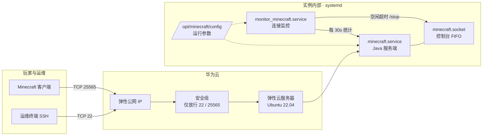

# Minecraft Java 服务器空闲自动关机实践

[](LICENSE)
[](https://support.huaweicloud.com/intl/en-us/)
[

> 在华为云上快速搭建一台「无人即停」的 Minecraft Java 游戏服务器。
> An idle-aware Minecraft Java game server on Huawei Cloud: auto-deploy on first boot, graceful auto-shutdown when the last player leaves.

---

## 1. 简介 [CRITICAL]

**中文**：本实践基于华为云弹性云服务器（ECS）搭建 Minecraft Java 版游戏服务器：实例首次启动即自动完成 Java 运行时安装、服务端下载校验与 systemd 服务注册；运行期间由监控服务统计游戏端口连接数，最后一名玩家断开并空闲超时后，自动保存世界并关闭实例，需要游玩时从控制台重新开机即可。面向游戏服运维、DevOps 工程师与个人服主，可作为按需启停类游戏服务器的参考架构。

**English**: This practice deploys a Minecraft Java Edition server on Huawei Cloud ECS. First boot auto-installs the Java runtime, verifies the server jar, and registers systemd units. A monitor service tracks game-port connections and gracefully shuts the instance down after the last player leaves; simply power the instance back on from the console when you want to play again.

### 核心能力

- **开机即部署**：`terraform apply` 后无需人工登录，首次启动自动完成全部安装配置
- **空闲自动关机**：玩家断开后按可配置阈值（默认 15 分钟）保存世界并优雅停机
- **配置与脚本分离**：堆内存与空闲阈值存放于实例内配置文件，修改后重启服务即生效
- **版本锁定与校验**：服务端 jar 下载地址与 SHA1 校验和固定，防劫持防损坏
- **一键创建与销毁**：全部资源由 Terraform 声明式管理

---

## 2. 目录 [MINOR]

- [1. 简介](#1-简介-critical)
- [2. 目录](#2-目录-minor)
- [3. 架构图](#3-架构图-minor)
- [4. 方案亮点](#4-方案亮点-minor)
- [5. 涉及云服务](#5-涉及云服务-minor)
- [6. 前置条件](#6-前置条件-critical)
- [7. 快速开始](#7-快速开始-critical)
- [8. 分步部署](#8-分步部署-minor)
- [9. 使用方法 / 验证](#9-使用方法--验证-critical)
- [10. 清理资源](#10-清理资源-minor)
- [11. 详细说明](#11-详细说明-minor)
- [12. 依赖](#12-依赖-minor)
- [13. FAQ / 故障排除](#13-faq--故障排除-minor)
- [14. 贡献指南](#14-贡献指南-minor)
- [15. 许可证](#15-许可证-critical)
- [16. 联系方式](#16-联系方式-critical)
- [17. 创建者 / 维护者](#17-创建者--维护者-critical)

---

## 3. 架构图 [MINOR]

> 玩家经弹性公网 IP 直达安全组收敛后的游戏端口；实例内部由三个 systemd 单元协同完成「服务 / 控制台 / 空闲监控」闭环。



**关键组件说明**：
- **弹性公网 IP + 安全组**：玩家接入入口，仅放行 22（运维）与 25565（游戏）端口，来源 IP 段可收敛
- **弹性云服务器**：2 核 4 GB Ubuntu 22.04，系统盘承载世界数据
- **minecraft.service / minecraft.socket**：游戏服务端 + 控制台 FIFO（可注入 `/stop`、`/say` 等命令）
- **monitor_minecraft.service**：空闲监控，超时后走「保存世界 → 宽限 → 关机」流程

---

## 4. 方案亮点 [MINOR]

- **零人工干预上线**：从实例创建到服务就绪全自动，部署动作一次性收敛在 Terraform 声明内
- **优雅停机不丢档**：关机前先经控制台 `/stop` 保存世界，而非直接终止进程
- **运行参数热调整**：堆内存 / 空闲阈值外置为配置文件，与业务脚本解耦
- **最小暴露面**：安全组双端口收敛 + 专用低权限服务用户 + 无任何云 API 凭据落盘
- **可复现**：服务端版本与校验和锁定，任何时间重新部署得到一致结果

---

## 5. 涉及云服务 [MINOR]

| 服务 | 用途 | 备注 |
|---|---|---|
| 弹性云服务器（ECS） | 运行 Minecraft 服务端 | s6.large.2（2 核 4 GB）· Ubuntu 22.04 |
| 虚拟私有云（VPC） | 网络平面 | 10.0.0.0/16，单可用区 |
| 子网 | 实例网络接入 | 10.0.1.0/24 |
| 安全组 | 访问控制 | 入站仅放行 22 / 25565 |
| 弹性公网 IP（EIP） | 玩家接入与实例出网 | 按流量计量，5 Mbit/s |

> **提示**：所有服务均可通过本仓库的 Terraform 一键创建；如需清理，请参见 [第 10 节「清理资源」](#10-清理资源-minor)。

> **资源规格与用量说明**：各服务的规格与部署用量说明见第 11 节「详细说明」。

---

## 6. 前置条件 [CRITICAL]

| 项 | 要求 | 说明 |
|---|---|---|
| **账号** | 已开通华为云账号并完成实名认证 | 个人/企业账号均可 |
| **权限** | 具备 VPC / ECS / EIP / 安全组创建与删除权限 | Tenant Administrator 或等效 |
| **Region** | 推荐 `cn-north-4`（北京四） | 可用区 `cn-north-4a` |
| **Terraform** | `>= 1.5.0` | IaC 部署工具 |
| **huaweicloud Provider** | `>= 1.96` | 华为云 Terraform Provider |
| **AK/SK** | 已创建访问密钥，运行时经环境变量提供 | 请勿写入仓库文件 |

> **凭据提供方式**：
> ```bash
> export HW_ACCESS_KEY="<AK>"
> export HW_SECRET_KEY="<SK>"
> ```
> 仓库内任何 `.tf` / 文档均使用占位符，**不出现真实凭据**。

---

## 7. 快速开始 [CRITICAL]

### 一键部署（推荐）

```bash
# 1. 克隆本仓库
git clone <本仓库 HTTPS URL> <本仓库根目录>
cd <本仓库根目录>

# 2. 配置访问凭据（见前置条件）
export HW_ACCESS_KEY="<AK>"
export HW_SECRET_KEY="<SK>"

# 3. 一键部署
cd infra
terraform init
terraform plan
terraform apply -auto-approve
```

> **部署耗时**：约 5 分钟（含实例首次启动自动安装 Java、下载服务端与拉起服务）。
> **完整步骤与每步预期输出**：参见 [第 8 节「分步部署」](#8-分步部署-minor)。

---

## 8. 分步部署 [MINOR]

### 步骤 1：初始化工作目录

```bash
cd infra
terraform init
```

**预期输出**：`Terraform has been successfully initialized!`

### 步骤 2：按需修改变量

```bash
cp terraform.tfvars.example terraform.tfvars
# 重点确认 allowed_cidr（建议收紧为本机/办公网段）与 admin_password（登录口令）
```

### 步骤 3：预演资源变更

```bash
terraform plan
```

**预期输出**：`Plan: 7 to add, 0 to change, 0 to destroy.`

### 步骤 4：执行部署

```bash
terraform apply -auto-approve
```

**预期输出**：`Apply complete! Resources: 7 added, 0 changed, 0 destroyed.`

### 步骤 5：记录关键输出

```bash
terraform output
```

**预期输出**：列出 `game_server_address`（玩家接入地址）等字段，请妥善保存用于后续验证。

---

## 9. 使用方法 / 验证 [CRITICAL]

> **验证说明**：本节所列命令为部署完成后的验证步骤。交付前已完成部署脚本仿真、脚本级功能测试与 IaC 静态校验；端到端实测需在华为云账号执行 `terraform apply` 后按本节逐项核对。请按本节步骤自行验证，确认业务功能可用后方可视为交付完成。

### 验证 1：获取接入地址

```bash
terraform output game_server_address
```

**预期输出**：
```
"<弹性公网IP>:25565"
```

### 验证 2：确认游戏端口可连通

```bash
nc -vz $(terraform output -raw eip_public_ip) 25565
```

**预期输出**：`succeeded`（或 `open`）。

### 验证 3：查看服务日志

```bash
# SSH 登录实例（口令见 admin_password 变量）
ssh root@$(terraform output -raw eip_public_ip)

# 游戏服务与监控服务日志
journalctl -u minecraft.service --no-pager | tail -20
journalctl -u monitor_minecraft.service --no-pager | tail -5
```

**预期输出**（关键行）：
```
[start] 启动 Minecraft 服务器：堆内存 -Xmx2048M -Xms2048M
[monitor] 监控启动：游戏端口 25565，检查间隔 30s，空闲关机阈值 900s
```

### 验证 4：业务端到端（推荐）

```bash
# Minecraft Java 客户端 → 多人游戏 → 添加服务器 → 填入 game_server_address
```

**预期结果**：能进入游戏世界；退出后保持无玩家状态达到空闲阈值（默认 15 分钟），
实例自动完成「保存世界 → 关机」，控制台可见实例状态变为「已停止」；
重新开机约 1 分钟后客户端可再次接入，世界数据保留。

---

## 10. 清理资源 [MINOR]

```bash
# 进入部署目录
cd infra

# 一键释放所有资源
terraform destroy -auto-approve
```

**预期输出**：`Destroy complete! Resources: 7 destroyed.`

> **避免资源残留**：
> - `terraform destroy` 仅释放 Terraform state 中追踪的资源；
> - 世界数据位于实例系统盘，随实例一并释放；如需保留世界，请先通过 SSH 备份 `/opt/minecraft/server/world` 等目录；
> - 若曾在控制台手工创建过资源（如额外 EIP），需手动释放。

---

## 11. 详细说明 [MINOR]

### 工作流程

1. `terraform apply` 创建 VPC / 子网 / 安全组 / EIP / ECS（user_data 注入部署脚本）；
2. 实例首次启动：安装 Java 17 → 写配置 → 落盘脚本与 systemd 单元 → 下载并校验服务端 → 拉起游戏服务与监控服务；
3. 玩家接入（TCP 25565）；监控服务每 30 秒统计 ESTABLISHED 连接数；
4. 最后一名玩家断开开始计时，任意玩家进入即重置；
5. 空闲超阈值：控制台 `/stop` 保存世界 → 宽限 20 秒 → `shutdown -h now` 关闭实例；
6. 控制台重新开机 → 服务自启 → 世界数据延续。

### 配置项（Terraform 变量）

| 变量 | 默认值 | 说明 |
|---|---|---|
| `region` | `cn-north-4` | 华为云区域 |
| `availability_zone` | `cn-north-4a` | 可用区 |
| `ecs_flavor` | `s6.large.2` | 实例规格（2 核 4 GB） |
| `allowed_cidr` | `0.0.0.0/0` | 22 / 25565 端口来源 IP 段，**部署前务必收紧** |
| `admin_password` | （示例值） | 实例登录口令（敏感变量） |
| `server_ram_mb` | `2048` | 服务端堆内存（MB） |
| `shutdown_timer_seconds` | `900` | 空闲关机阈值（秒，不建议低于 300） |
| `server_jar_url` / `server_jar_sha1` | 1.20.4 锁定值 | 服务端下载地址与 SHA1 校验和 |

### 运行时文件布局（实例内）

| 路径 | 说明 |
|---|---|
| `/opt/minecraft/config` | 运行参数（堆内存 / 空闲阈值） |
| `/opt/minecraft/server/start` | 启动入口（读取配置 → exec java） |
| `/opt/minecraft/server/stop` | 安全停止（向控制台 FIFO 写 `/stop`） |
| `/opt/minecraft/server/monitor` | 连接监控与空闲关机 |
| `/opt/minecraft/server/server.jar` | Minecraft 服务端（SHA1 校验） |
| `/run/minecraft.stdin` | 控制台 FIFO（`echo "/say hi" > /run/minecraft.stdin`） |
| `/etc/systemd/system/minecraft.{service,socket}` | 游戏服务单元 |
| `/etc/systemd/system/monitor_minecraft.service` | 监控服务单元 |

---

## 12. 依赖 [MINOR]

### 主要依赖

| 名称 | 版本 | 用途 |
|---|---|---|
| Terraform | `>= 1.5.0` | IaC 编排 |
| huaweicloud Provider | `>= 1.96` | 华为云资源声明 |
| OpenJDK | 17 | Minecraft 服务端运行时 |
| Minecraft 服务端 | 1.20.4 | 游戏服务端（Mojang 官方分发，版本锁定 + SHA1 校验） |

---

## 13. FAQ / 故障排除 [MINOR]

### Q1：部署后无法连接游戏端口？

**A**：首次启动自动部署约需 3–5 分钟，请先确认实例状态「运行中」且 `journalctl -u minecraft.service` 出现启动完成日志；再用 `nc -vz <IP> 25565` 验证端口连通性。

### Q2：实例总是自动关机？

**A**：无玩家在线时自动关机是本实践的预期行为。需要常驻时：调大 `/opt/minecraft/config` 中的 `SHUTDOWN_TIMER_SECONDS`，或执行 `systemctl disable --now monitor_minecraft.service` 关闭监控。

### Q3：想改堆内存 / 空闲阈值？

**A**：SSH 登录后编辑 `/opt/minecraft/config`，执行 `systemctl restart minecraft.service monitor_minecraft.service` 生效；也可改 `terraform.tfvars` 对应变量后重新 apply（下次重建实例时生效）。

### Q4：服务端版本怎么升级？

**A**：更换 `infra/terraform.tfvars` 中的 `server_version` / `server_jar_url` / `server_jar_sha1` 三个变量为新版本的锁定值，重新 apply。

### 故障排查清单

| 现象 | 可能原因 | 排查方法 |
|---|---|---|
| SSH 连不上 | `allowed_cidr` 未包含本机公网 IP | 收紧/修正 `allowed_cidr` 后重新 apply |
| 服务端下载失败 | 实例出网异常 | SSH 内执行 `curl -I <server_jar_url>` 排查 |
| 服务反复重启 | 堆内存超过实例可用内存 | 调低 `RAM_MB`（4 GB 实例建议 ≤ 3072） |
| 世界数据丢失 | 实例已销毁且未备份 | 定期 SSH 备份 `/opt/minecraft/server/world` |

---

## 14. 贡献指南 [MINOR]

欢迎提交 Issue 与 PR。请遵循以下流程：

1. **Issue**：描述问题 / 建议（含复现命令、预期 / 实际输出、截图）
2. **PR**：基于 `main` 分支新建 feature 分支；提交前运行 `terraform validate`
3. **Code Review**：由仓库维护者审核通过后合并

---

## 15. 许可证 [CRITICAL]

本实践采用 **MIT No Attribution** 许可证发布。详见仓库根目录 [`LICENSE`](LICENSE) 文件。

```
MIT No Attribution

Copyright (c) Huawei Cloud

Permission is hereby granted, free of charge, to any person obtaining a copy
of this software... (no attribution required)
```

> 许可证溯源与相关声明随仓库提供。

---

## 16. 联系方式 [CRITICAL]

| 项 | 内容 |
|---|---|
| **联系方式** | 提交 Issue / PR |
| **反馈渠道** | 见 [第 14 节](#14-贡献指南-minor) |

---

## 17. 创建者 / 维护者 [CRITICAL]

| 项 | 内容 |
|---|---|
| **创建者** | zhangcheng123321 |
| **维护者** | zhangcheng123321 |
