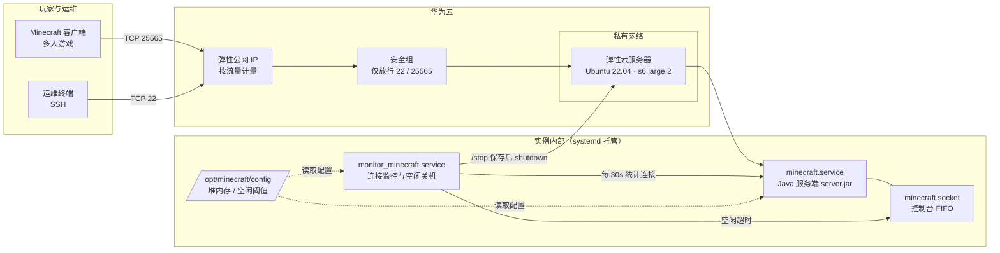

# 架构说明

> 本实践在华为云上搭建一台**无人值守的 Minecraft Java 游戏服务器**：开机即自动完成部署，
> 玩家断开连接后自动保存世界并关机，需要游玩时从控制台重新开机即可。
> 全程使用 Terraform 声明式管理，业务脚本与 systemd 单元随仓库交付。

## 1. 架构总览

## 2. 组件清单

| 组件 | 形态 | 职责 |
|---|---|---|
| 私有网络 / 子网 | `huaweicloud_vpc` + `huaweicloud_vpc_subnet` | 单可用区网络平面，CIDR 10.0.0.0/16 |
| 安全组 | `huaweicloud_networking_secgroup` + 两条入站规则 | 仅放行 SSH（22）与游戏端口（25565），来源受 `allowed_cidr` 约束；出方向使用默认全放行 |
| 弹性公网 IP | `huaweicloud_vpc_eip` | 玩家接入入口，同时供实例出网（下载服务端与依赖） |
| 弹性云服务器 | `huaweicloud_compute_instance` | Ubuntu 22.04，2 核 4 GB，GPSSD 系统盘 40 GiB |
| 首次启动部署 | 实例 `user_data` | 安装 Java 17、写入配置、落盘脚本与 systemd 单元、下载并校验服务端、拉起服务 |
| 游戏服务 | `minecraft.service` + `minecraft.socket` | 以 `minecraft` 系统用户运行 `server.jar`；控制台标准输入经 FIFO 注入 |
| 空闲监控 | `monitor_minecraft.service` | 每 30 秒统计 25565 端口 ESTABLISHED 连接，空闲超时后执行安全关机 |

## 3. 工作流程

1. **开机即部署**：`terraform apply` 创建实例，`user_data` 在首次启动时自动完成全部安装与配置（约 3–5 分钟），无需人工登录操作。
2. **玩家接入**：客户端「多人游戏 → 添加服务器」填入 `<弹性公网IP>:25565` 即可进入游戏。
3. **连接监控**：`monitor` 脚本每 30 秒执行 `ss -ant state established`，统计游戏端口的活跃连接数。
4. **空闲计时**：最后一名玩家断开后开始计时；期间任何玩家进入都会重置计时。
5. **安全停机**：空闲时长达到阈值（默认 900 秒）后，先通过 FIFO 向控制台写入 `/stop`（服务端自动保存世界并退出），等待 20 秒保存宽限，随后 `shutdown -h now` 关闭实例。
6. **按需重启**：实例关机后计算资源随之释放；下次游玩前在华为云控制台（或 API）启动该实例，系统服务随开机自动拉起，世界数据保留在系统盘。

## 4. 关键设计点

- **配置外置**：堆内存（`RAM_MB`）与空闲阈值（`SHUTDOWN_TIMER_SECONDS`）存放于 `/opt/minecraft/config`，与运行业务脚本分离，修改后 `systemctl restart` 即生效，不必改脚本。
- **优雅停止**：停机走「控制台 `/stop` → 世界保存 → 关机」路径，避免直接终止进程导致世界数据损坏。
- **socket 注入控制台**：`minecraft.socket` 以 FIFO 形式向 `server.jar` 的标准输入注入命令，运维可随时 `echo "/say hello" > /run/minecraft.stdin` 与游戏内广播。
- **版本锁定与完整性**：服务端 jar 的下载地址与 SHA1 校验和在 Terraform 变量中显式固定，首次启动下载后强制校验，防止链路劫持或文件损坏。
- **最小权限**：游戏服务以专用系统用户 `minecraft`（禁登录 shell）运行；监控服务仅需要关机权限，以 root 运行且不监听任何网络端口。
- **所有权让渡**：实例的 `user_data` 与 `admin_pass` 为部署期/运行期可变更字段，已在 Terraform 中声明 `ignore_changes`，避免后续 `apply` 回滚运行期改动。

## 5. 安全设计

| 控制项 | 措施 |
|---|---|
| 网络暴露面 | 安全组仅放行 22 与 25565，来源 IP 段由 `allowed_cidr` 收敛；实例无其他入站面 |
| 凭据管理 | 登录口令经敏感变量注入，不落盘到仓库；部署过程不需要任何云 AK/SK（实例自身无云 API 调用） |
| 服务权限 | 游戏服务专用低权限用户；监控脚本仅执行「读连接数 / 发 /stop / 关机」三类固定动作 |
| 数据完整性 | 关机前强制保存世界；系统盘随实例保留，重开机后世界继续 |

## 6. 设计取舍

- **配置来源选型**：堆内存与空闲阈值属于低频变更的运行参数，选用「实例内配置文件 + systemd 重启生效」方案，而非引入外部配置服务——游戏服务器本身已在实例内闭环，外部配置服务只会增加凭据管理与网络依赖，不改变业务结果。
- **部署通道选型**：采用实例首次启动注入（`user_data`）完成全部安装，部署动作一次性收敛在 Terraform 声明内，避免额外引入批量命令执行通道。
- **监控实现选型**：连接统计直接读取内核连接表（`ss`），不依赖云监控指标——游戏端口的 ESTABLISHED 连接数即在线玩家数，本地读取零延迟、零依赖，且阈值判断逻辑完全自主可控。
- **关机语义**：实例内 `shutdown -h now` 依托公共镜像内置的虚拟化驱动，将 ACPI 电源事件上报云平台，实例状态随之变为「已停止」；公共镜像均自带该能力，无需额外安装代理。
